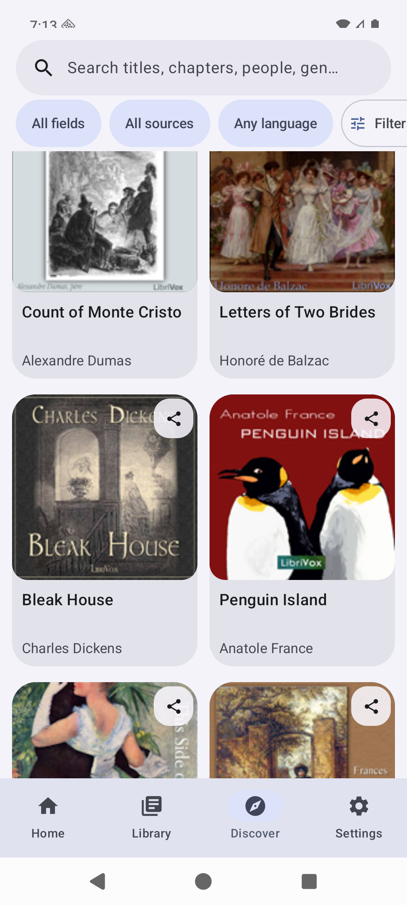
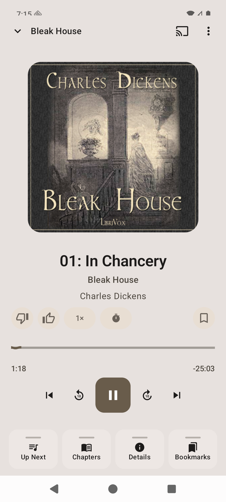
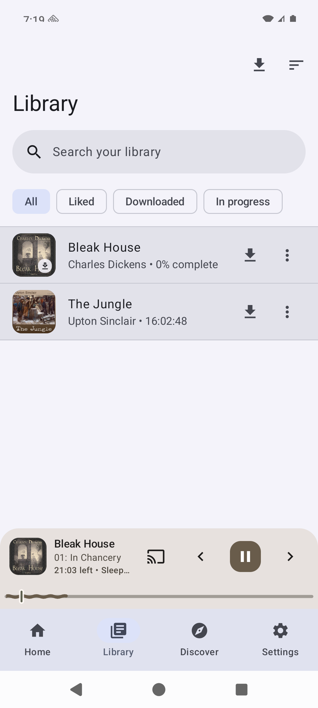
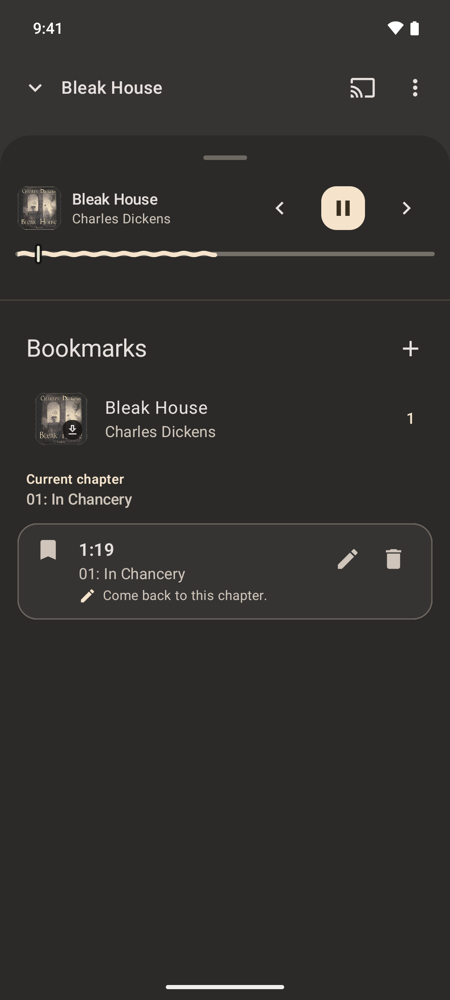
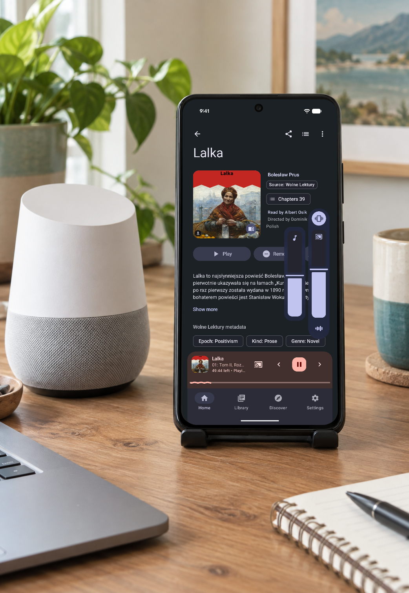
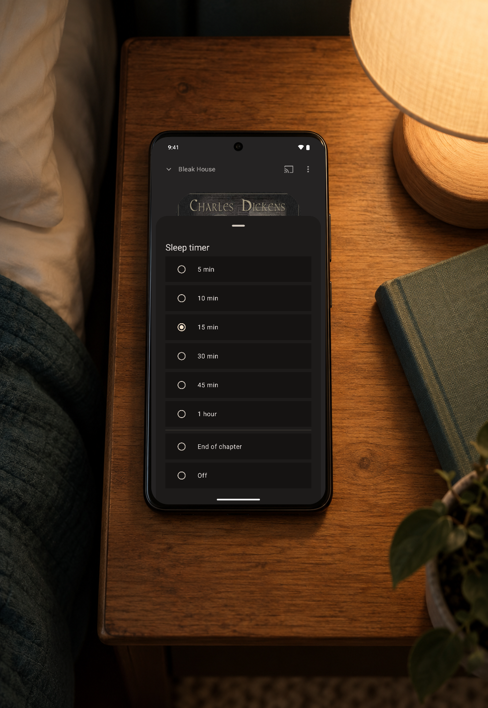

# LibriVox Mobile

<p>
  
</p>

LibriVox Mobile is a free, open-source audiobook app for Android and iOS. Listen to books from LibriVox, Lit2Go, and Wolne Lektury, or download chapters to listen offline.

There are no ads, subscriptions, in-app purchases, or paid upgrades. All features are free, and no account is required.

[Website](https://ababilinski.github.io/librivox-mobile/) · [Privacy policy](https://ababilinski.github.io/librivox-mobile/privacy-policy/) · [Support](https://ababilinski.github.io/librivox-mobile/support/)

## Audiobook sources

The books and recordings come from these projects. Book details include source links and reader credits.

| Source | What it provides |
| --- | --- |
| [LibriVox](https://librivox.org/) | Public-domain books recorded by volunteers around the world. |
| [Lit2Go](https://etc.usf.edu/lit2go/) | Stories and poems from the University of South Florida's educational collection. |
| [Wolne Lektury](https://wolnelektury.pl/) | Polish literature and audiobooks from the Wolne Lektury digital library. |

LibriVox is enabled by default. Turn on the other catalogs in Settings and choose the languages you want to browse.

This app is independent and is not affiliated with or endorsed by these projects. Recordings, artwork, and catalog information retain their source licenses. The app's MIT license applies to its code, not to that material. Public-domain status varies by country, so check a work's rights where you live before downloading or using it.

## Listening

- Stream chapters or download them for offline listening.
- Save books to your library, keep your listening progress, and add bookmarks with notes.
- Adjust playback speed, set a sleep timer, and move between chapters.
- Keep listening while using other apps, with background playback and media controls.
- Cast to compatible Google Cast speakers, TVs, and receivers on the same local network.
- Visit the original source pages and available donation links to support the projects that provide the books.

## Screenshots

<p>
  
  
  
  
</p>

Illustrative scenes using app screenshots:

<p>
  
  
  
</p>

## Build for Android

Use JDK 21 and Android SDK 37. The app runs on Android API 36 or later.

```bash
./gradlew :app:assembleDebug
```

To install on a connected device or emulator:

```bash
./gradlew :app:installDebug
```

## Build for iOS

Use Xcode with the iOS 26 SDK and CocoaPods. The app requires iOS 26 or later.

Install the Google Cast SDK dependency and open the workspace:

```bash
cd ios
pod install
open LibriVoxMobile.xcworkspace
```

Select the `LibriVoxMobile` scheme and a simulator in Xcode. Use your own signing team to run on a physical device.

Build through `LibriVoxMobile.xcworkspace` so CocoaPods links the Cast SDK. Run `pod install` again after changing the Podfile or regenerating the Xcode project.

## Website

The GitHub Pages site is in `docs/`. Use Node.js 18 or later to preview it locally:

```bash
npm run serve
```

Open `http://127.0.0.1:4173/`. Run `npm run check:site` to check the site's HTML, CSS, and local links.

The homepage uses the editorial design, with a book gallery and all listening tools shown together. Content and navigation remain available without JavaScript; shared animations enhance the page when motion is enabled.

Explore the collection highlights at `http://127.0.0.1:4173/sources/`. The Sources page links to original title pages, official donation guidance, and catalog highlights. Project Gutenberg’s ebook total is separate from audio availability.

Run `python3 scripts/generate-site-assets.py` to prepare 26 website assets (requires Pillow, listed in `scripts/requirements-play-assets.txt`). Original illustrations and proportional release captures live in `docs/assets/product/`; its manifest records provenance and hashes. The website uses local assets and system fonts. Shared page entrances and scroll reveals respect reduced motion and keep content visible without JavaScript. `npm run build` validates `docs/`, which GitHub Pages serves directly.

## Support and contributions

For bugs or feature requests, [open an issue](https://github.com/ababilinski/librivox-mobile/issues). Code and documentation contributions are welcome. For help, email [adrian@babilinapps.com](mailto:adrian@babilinapps.com).

## License

MIT. See [LICENSE](LICENSE).
